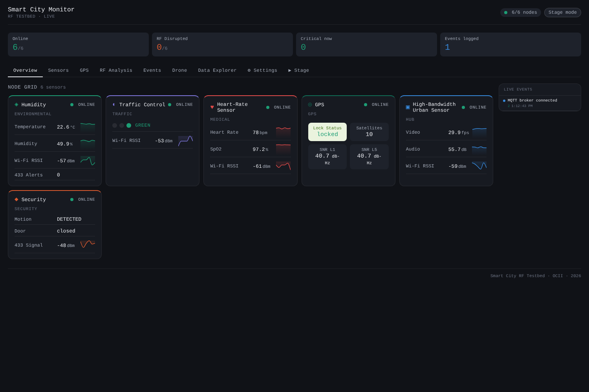
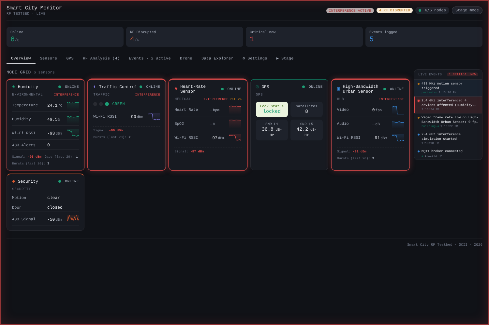
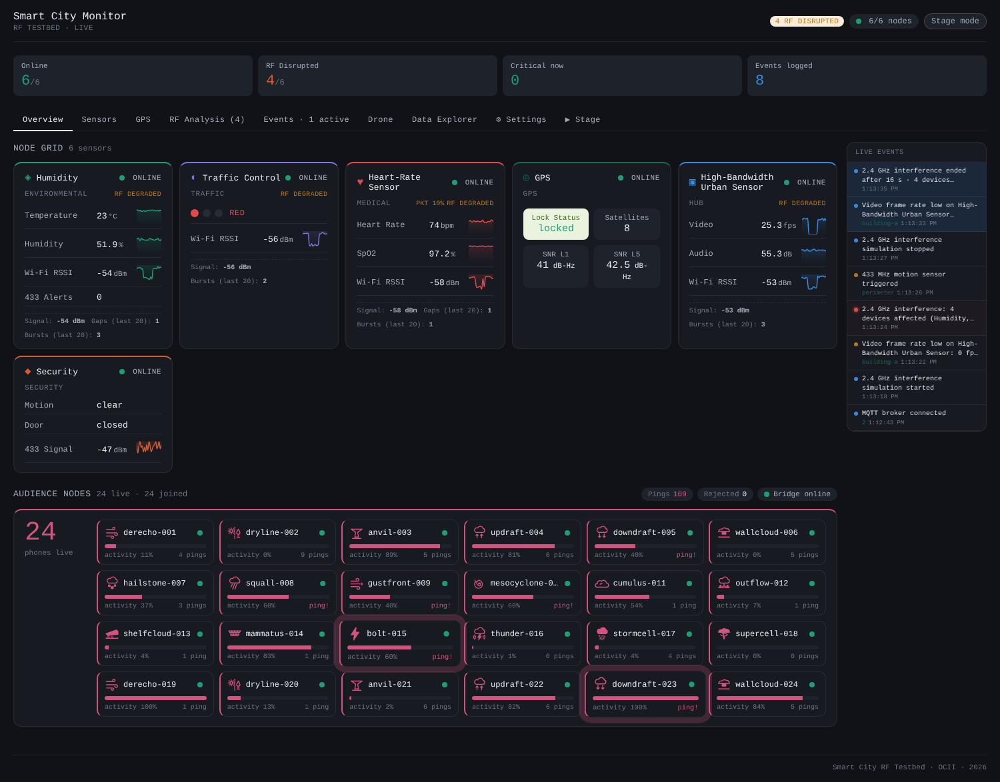
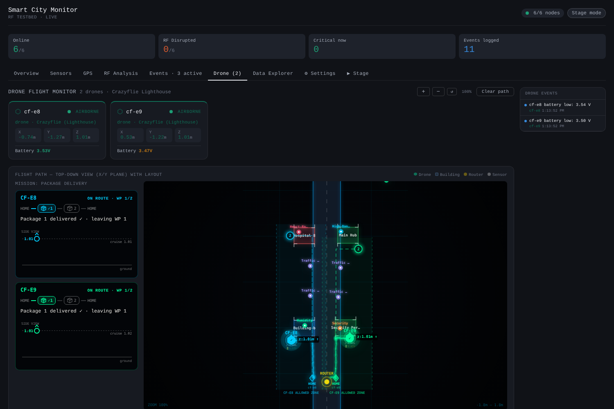
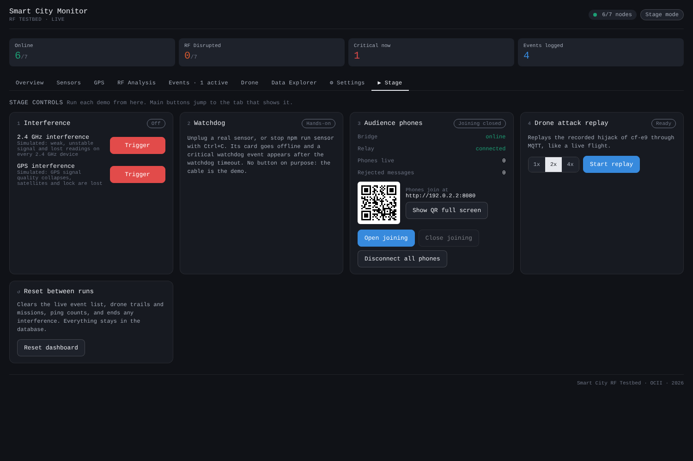
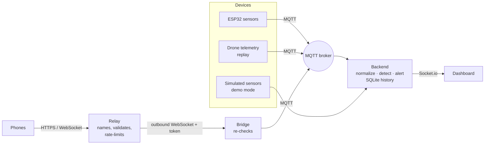

# Smart City Monitor: an event-driven testbed you can run on a laptop

The demo platform from the ThunderPlains 2026 talk **"When Every Device Speaks a Different Language: Building Resilient Event-Driven Systems."**

Sensors, drones and a room full of phones all speak to one MQTT event bus. A Node.js backend normalizes everything, detects trouble (interference, silent devices, drones off their route), and streams it to a live React dashboard.

You don't need any hardware. Demo mode simulates the city's sensors, the drone demo replays two real recorded Crazyflie flights, and your own phone can join as a sensor node.



## Quick start

You need **[Node.js 22 LTS or newer](https://nodejs.org)** and git.

```bash
git clone https://github.com/<you>/thunderplains-smartcity.git
cd thunderplains-smartcity
npm install
npm start
```

The dashboard opens at **http://localhost:3000**. That's it. `npm start` runs everything in one window: an MQTT broker, the backend, the dashboard, the phone relay and the demo helpers. **Ctrl+C stops it all.**

When it's up, the window prints the addresses you need, using **your laptop's own address on your Wi-Fi** (it's detected automatically, so yours will be different):

```
  Dashboard        http://localhost:3000
  Phones join at   http://<your-laptop-ip>:8080   (QR code in the Stage tab)
  ESP32 / MQTT     <your-laptop-ip>:1883   topic smartcity/<node-id>/<metric>
```

Phones must be on the same Wi-Fi as the laptop to join this way. ESP32s need `<your-laptop-ip>` as their MQTT server; if your laptop's address changes, reserve one for it in your router's settings.

## The demos

Everything is driven from the **Stage** tab.

| # | Demo | What to do | What you'll see |
|---|------|------------|-----------------|
| 1 | **Interference** | Stage → *Trigger* (2.4 GHz or GPS) | Every affected device degrades together, the backend groups them into **one incident** instead of a flood of alerts, and it closes itself when you press *Clear* |
| 2 | **Watchdog** | Run `npm run sensor` in a second terminal, then press Ctrl+C in it | A new sensor tile appears by itself; when you "unplug" it, it goes offline and raises a critical alert. Silence is data. |
| 3 | **Audience phones** | Stage → *Open joining*, then scan the QR code with your phone (same Wi-Fi as the laptop) | Each phone becomes a storm-named sensor node. Tap the ping button and watch it flash on the dashboard. Close the tab and it goes offline; *Disconnect all phones* removes them. |
| 4 | **Drone attack replay** | Stage → *Start replay* | The Drone tab opens on its own. Two recorded Crazyflie flights fly their mission; one gets hijacked mid-flight and the dashboard flags it **off route**. |



<details>
<summary>More screenshots</summary>

**Audience phones as sensor nodes**


**Drone mission monitor**


**Stage controls**


</details>

### Test the phone demo without phones

```bash
npm run phones:test          # 40 simulated phones join (open joining first)
npm run phones:test-leave    # 40 phones that all "close the tab" after 30 s
npm run phones:test-attack   # 20 phones plus clients sending garbage; watch "Rejected" climb
```

### Shaking vs tapping

Phones only share motion (shake) over **HTTPS**. On your local Wi-Fi the page is plain HTTP, so phones join and tap but don't shake. To get shake, deploy the relay for free and point the launcher at it: [docs/DEPLOY_RELAY.md](docs/DEPLOY_RELAY.md). Hosting it publicly also means phones can join from any network, including cellular.

## How it works



The ideas the talk is about, and where to find them in the code:

- **One event shape on one bus.** Every device publishes to `smartcity/<node-id>/<metric>` with `{"value", "unit", "collected_ms"}`. The backend never needs to know what kind of device sent it. (`backend/server.js`, MQTT handler)
- **Timestamp at the source.** `collected_ms` is the device's own clock, so a backlog flushed after an outage is recognized as late readings, not a burst of new ones.
- **Silence is data.** Each device's rhythm is learned from its heartbeats; a gap is measured against what that device normally does, and a device that stops raises an alert.
- **Alert on state changes, not samples.** Alerts have an on-delay, deadband and off-delay, and devices hit by the same cause are grouped into one incident (the same ideas as Prometheus Alertmanager and ISA-18.2).
- **Untrusted devices stop at an edge.** Phones never touch the broker. The relay assigns their names and accepts one tiny message shape, and the bridge checks again before anything reaches the bus. (`relay/`, `bridge/`)

## Add your own sensor

Point any MQTT client at the address `npm start` prints and publish:

```
topic:    smartcity/my-sensor/temperature
payload:  {"value": 22.4, "unit": "°C", "collected_ms": 123456}
```

A plain number works too. The new node shows up on the dashboard on its own. To give it a name, building and alert thresholds, add it to `backend/layout.json` with the same ID.

- `npm run sensor` is a pretend ESP32 you can read as an example (`tools/fake-sensor.js`).
- `firmware/gps_node/` is a real ESP32-S3 + u-blox NEO-F10N (GPS L1/L5) sketch, with wiring and Arduino setup in its README.
- `npm run check-sensors` watches the bus and tells you how often each sensor really sends, which is useful when a new device looks wrong.

Send `wifi_rssi` regularly from Wi-Fi devices so the RF Analysis tab can judge their link.

## What's in the repo

| Folder | What it is |
|---|---|
| `backend/` | Express + Socket.io + MQTT. Normalizes events, learns device rhythms, runs the alert engine, keeps history in SQLite (`backend/data/`, created on first run). Alerting policy: `backend/config/alerting.json` |
| `frontend/` | The dashboard (React + Vite) |
| `broker/` | A built-in MQTT broker, so you don't have to install Mosquitto |
| `relay/` | The phone page and the gatekeeper for untrusted devices. Runs locally, or deploy it (see `render.yaml`) |
| `bridge/` | Connects the relay to MQTT; also has the phone simulator (`swarm-test.js`) |
| `drone-replay/` | Replays the recorded Crazyflie flights through MQTT, as if they were flying live |
| `stage/` | `npm start` (the launcher) and the agent behind the Stage tab's buttons |
| `tools/` | `fake-sensor.js`, `diag.js` (sensor check) |
| `firmware/` | ESP32 example sketch |

## Settings

It works with no configuration. To change something, copy `stage/stage.config.example.json` to `stage/stage.config.json` and keep only the lines you need. For example:

- `"broker": "external"` plus `"mqttBroker": "mqtt://localhost:1883"` uses your own Mosquitto
- `"demoMode": false` turns the simulated sensors off (real devices only)
- `"relay": "remote"` with `relayUrl` and `stageToken` uses a deployed relay
- `"openBrowser": false` stops the dashboard opening by itself

The dashboard's **Settings** tab changes alert thresholds live.

**When** alerts fire, clear and group (the waits, recovery margins, incident grouping, drone and phone timeouts) is set in `backend/config/alerting.json`, not in the code. [docs/ALERTING.md](docs/ALERTING.md) explains every value and how to override them for one site or test.

The Stage tab's simulated interference builds up over a few seconds, reaching each device at a slightly different time, like a real source would. `backend/config/simulation.json` sets how fast (`rampUpMs`, `staggerMs`; 0 = instant) and whether demo mode also triggers random interference by itself (`autoInterference`, off by default).

## Troubleshooting

- **"Port … already in use".** Something from an earlier run is still going. On Mac or Linux, the launcher prints the exact `kill` command; on Windows, close the other terminal windows.
- **`Cannot find module @rollup/rollup-…`.** This happens when `node_modules` was copied from another computer. Delete `node_modules` and `package-lock.json`, then run `npm install` again.
- **My phone can't open the join page.** It must be on the same Wi-Fi as the laptop. Some networks (hotels, conferences, eduroam) block devices from reaching each other; use your phone's hotspot for the laptop and phones, or deploy the relay.
- **Windows asks about the firewall.** Allow Node.js on private networks so phones and ESP32s can reach the laptop.
- **"Node … is too old".** Install Node 22 LTS or newer from https://nodejs.org.

## A note on security

This is a demo built to be easy to run. The built-in broker accepts anyone on your network and the dashboard has no login, so run it on a network you trust. The phone path is the one part designed for strangers: phones only ever talk to the relay, never to your broker.

## Credits

Built at the Oklahoma Cyber Innovation Institute (OCII) smart city testbed. The drone flights in `drone-replay/flights/` are real recordings from Crazyflie trials with Lighthouse positioning, including a hijacked flight.

MIT License. See [LICENSE](LICENSE).
